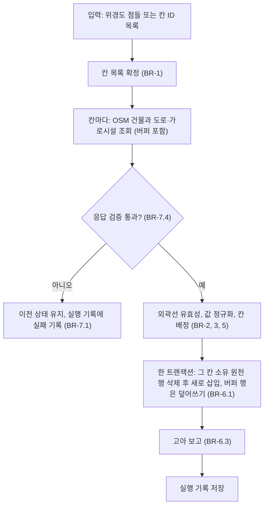
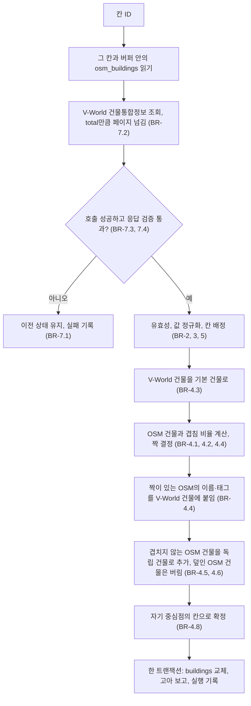

# U1 데이터 기반 — Business Logic Model

V-World 시험 결과와 재확인 답변(Q1=B, Q2=B)을 반영해 다시 썼다.

## 책임 나누기

| 컴포넌트 | 하는 일 | 쓰는 테이블 |
|---|---|---|
| C1 `cells.py` | 칸 지정, OSM 건물(이름·태그용)과 도로·가로시설 수집 | `cells`, `osm_buildings`, `street_features` |
| C2 `register.py` | V-World 건물통합정보 수집, **건물 조립**(V-World 기본 + OSM 이름·태그) | `gis_buildings`, `buildings` |
| C7 `db.py` | 스키마, 칸 단위 트랜잭션, 고아 보고 | 모든 테이블, `collection_runs` |

- 파일 이름 `register.py`는 그대로 둔다(예전 설계의 흔적이지만 이름 변경 비용이 더 크다).
- 서비스 S1은 항상 C1 → C2 순서로 실행한다. C2는 그 시점의 원천 테이블 전체에서 `buildings`를 다시 만든다.

## 흐름 1. 칸 수집 (C1)



## 흐름 2. 건물 조립 (C2)



## 건물 조립 예시

```text
V-World 건물 가가 있고 그것과 겹치는 OSM 건물 o가 있다 (겹침 0.5 이상):
  결과: 건물 하나, 외곽선과 층수는 V-World(가), 이름과 지붕 같은 태그는 OSM(o)에서 붙임

OSM 건물 o가 V-World 건물 가, 나 둘과 겹친다:
  o는 더 많이 겹치는 쪽(예: 가) 하나의 짝이 된다. 나는 OSM 정보 없이 V-World 건물 그대로.

OSM 건물 o가 V-World의 어떤 건물과도 안 겹친다:
  결과: 독립 건물(source=osm). V-World에 없는 새 건물을 잃지 않는다.

OSM 건물 o가 V-World 건물 가와 겹치지만 가의 짝은 다른 OSM 건물 o2다:
  o는 버린다(덮인 건물). 박스가 겹치는 것을 막는다.
```

## 데이터 흐름 요약

```text
OSM ---------------> osm_buildings, street_features --+
V-World 건물통합정보 -> gis_buildings -----------------+-> 조립 -> buildings -> U2, U3, U4
```

## 다른 유닛과의 약속
- U2는 `buildings`(외곽선)와 `street_features`를 읽는다. 도로 폭은 U2가 정한다.
- U3은 `buildings`의 중심점을 보고 캡처 지점을 계획한다.
- U4는 `buildings`의 V-World 층수·높이와 OSM 참고값(`osm_height_m`, `osm_levels`)을 출처별로 읽고 합치는 규칙을 정한다(BR-5.4).
- `status=invalid`인 건물은 모든 유닛이 건너뛴다.
- U1이 건축HUB API를 쓰지 않으므로 `register_matches` 테이블은 없다. 대장 속성은 `buildings`에 있다.

## 확인된 것과 아직 모르는 것
- 확인됨(2026-10-13 시험): V-World 호출 성공, `domain` 파라미터 불필요, 한 번에 최대 1000건, 외곽선과 층수·높이 제공. 칸 소유 건물이 대략 85~203개이고 층수는 88~93%, 높이는 45~62%가 값을 가진다.
- 모름: 한 건물이 여러 폴리곤인 MultiPolygon이 얼마나 흔한지, 건물 고유 키 필드의 이름(`gis_key`가 될 필드), 응답에 기준 시점이 있는지. 코드 생성에서 확인한다.
- 겹침 기준 0.5와 버퍼 150 m는 시험값이다. 첫 칸 결과를 보고 조정한다.
