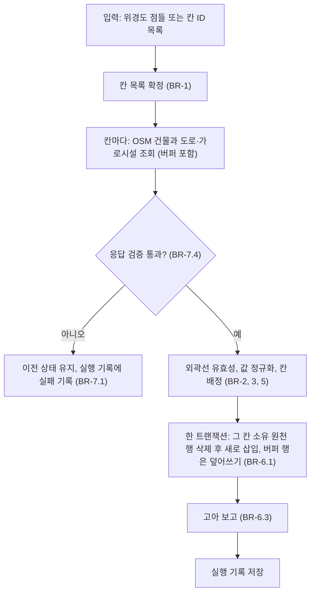
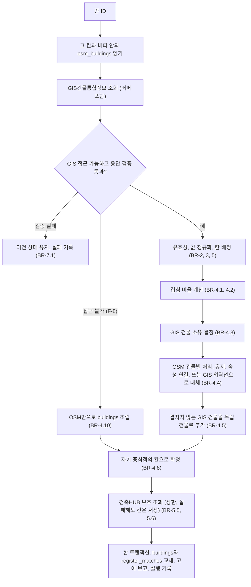

# U1 데이터 기반 — Business Logic Model

## 책임 나누기 (Application Design 수정)

Q1=C와 Q7=B로 건물 조립이 필요해져서 C1과 C2의 경계를 이렇게 정한다.

| 컴포넌트 | 하는 일 | 쓰는 테이블 |
|---|---|---|
| C1 `cells.py` | 칸 지정, OSM 건물 원천 수집, 도로·가로시설 수집 | `cells`, `osm_buildings`, `street_features` |
| C2 `register.py` | GIS건물통합정보 수집, **건물 조립**(매칭과 대체), 건축HUB 보조 조회 | `gis_buildings`, `buildings`, `register_matches` |
| C7 `db.py` | 스키마, 칸 단위 트랜잭션, 고아 보고 | 모든 테이블, `collection_runs` |

- 서비스 S1은 항상 C1 → C2 순서로 실행한다. C2는 언제나 그 시점의 원천 테이블 전체에서 `buildings`를 다시 만든다(원천이 최신이 아니면 `buildings`도 낡은 채로 남으므로 S1을 한 묶음으로 돌린다).

## 흐름 1. 칸 수집 (C1)



## 흐름 2. 건물 조립과 속성 연결 (C2)



## 건물 조립 예시 (BR-4.4)

```text
OSM o 하나가 GIS 가, 나를 덮는다 (겹침 0.5 이상):
  G(o) = {가, 나}  ->  o를 버리고 가, 나를 각각 건물로 만든다 (replaces_osm_id = o)
                        o의 이름·태그는 o와 더 많이 겹치는 쪽에 붙인다

OSM o 하나가 GIS 가 하나와 겹친다:
  G(o) = {가}      ->  o의 외곽선을 쓰고 가의 층수 등 속성을 붙인다

OSM에 없는 GIS 건물 다:
  어떤 o와도 겹치지 않음 -> 다를 독립 건물로 추가 (OSM에 없는 건물을 채움)
```

## 데이터 흐름 요약

```text
OSM -> osm_buildings, street_features -+
GIS건물통합정보 -> gis_buildings -------+-> 조립 -> buildings, register_matches -> U2, U3, U4
건축HUB(보조) ---------------------------+
```

## 다른 유닛과의 약속
- U2는 `buildings`(외곽선)와 `street_features`를 읽는다. 도로 폭은 U2가 정한다(Q4=B).
- U3은 `buildings`의 중심점을 보고 캡처 지점을 계획한다.
- U4는 `register_matches`, `osm_buildings`의 정규화된 값(`height_m`, `levels`)을 출처별로 읽고 합치는 규칙을 정한다(BR-5.4).
- `status=invalid`인 건물은 모든 유닛이 건너뛴다.

## 아직 모르는 것 (코드 생성에서 확인)
- GIS건물통합정보의 레이어, 필드 이름, 응답 형식. 활용신청 후 확인한다(신청 전에는 BR-4.10으로 진행).
- 건축HUB 하루 호출 한도(BR-5.6의 상한 값을 정하는 근거).
- 겹침 기준 0.5와 버퍼 150 m는 시험값이다. 첫 칸 결과를 보고 조정한다.
