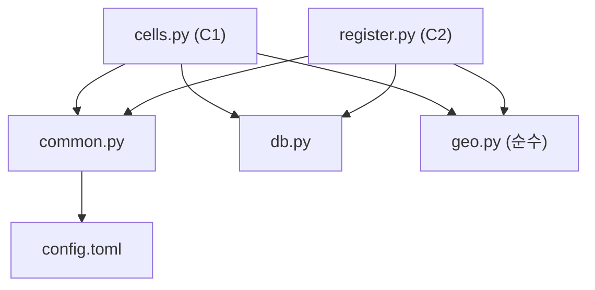

# U1 데이터 기반 — Logical Components

큐, 캐시, 회로 차단기, 별도 서비스는 없다(D-N3). 아래가 U1이 만드는 논리 컴포넌트 전부다.

## 코드 컴포넌트 (`src/`)

| 컴포넌트 | 파일 | 책임 | 순수 / 입출력 |
|---|---|---|---|
| 기하·정규화 | `geo.py` | 면적 무게중심, 칸 배정, 외곽선 유효성, 겹침 비율, OSM·V-World 값 정규화, 건물 조립(`assemble`) | 순수 (입출력 없음, 속성 기반 테스트 대상) |
| 데이터 계층 | `db.py` | 연결(외래 키 켬), 스키마, 칸 단위 교체 트랜잭션(`replace_cell_rows`), 고아 보고(`orphans`), 백업(`backup`, 최근 5개 보관) | 입출력(SQLite) |
| 공용 도우미 | `common.py` | 설정 읽기와 검증(`load_config`), 환경변수 읽기(앞뒤 공백 제거), 로깅 설정(JSON 파일 + 콘솔 요약 + 비밀값 필터), 재시도와 간격이 있는 HTTP GET, 최상위 실행기(`run_cli`) | 입출력 |
| 칸 수집기 (C1) | `cells.py` | 칸 지정, OSM 건물(이름·태그용)과 도로·가로시설 수집 | 입출력 |
| 건물 조립기 (C2) | `register.py` | V-World 수집(페이지 넘김), 조립 호출, DB 저장 | 입출력 |

의존 방향: `cells.py`, `register.py` → `common.py`, `db.py`, `geo.py`. `geo.py`와 `common.py`는 서로를 쓰지 않고, `db.py`는 `geo.py`를 쓰지 않는다. 순환은 없다.

## 설정, 데이터, 테스트, CI

| 항목 | 위치 | git |
|---|---|---|
| 설정 | `config.toml` (키 목록은 nfr-design-patterns 3장) | 포함 |
| DB | `data/map.db` | 제외 |
| 로그 | `data/logs/<스크립트>-<날짜>.jsonl` | 제외 |
| 백업 | `data/backups/map-<날짜시각>.db` (최근 5개) | 제외 |
| 비밀값 | `.env` (`VWORLD_KEY`, `DATA_GO_KR_KEY`) | 제외 |
| 테스트 | `tests/` : `generators.py`(공용 도메인 생성기, PBT-07), `test_*.py`, `fixtures/`(응답 샘플), `requirements.txt` | 포함 |
| CI | `.github/workflows/ci.yml` | 포함 |
| 복구 절차 | `aidlc-docs/construction/u1-data-foundation/nfr-design/nfr-design-patterns.md` 6장 | 포함 |

## 테스트 구성 (PBT-07, N-8)
- `tests/generators.py`: 건물 외곽선(단순 다각형, 칸 안의 좌표), V-World 속성 문자열(`'5'`, `'18.15'`, `''`), OSM 태그 문자열(`12`, `12 m`)을 만드는 생성기를 한 곳에 둔다.
- 속성 P-1~P-10은 순수 함수(`geo.py`)와 `db.py`(재수집, 고아 보고, 페이지 합치기)에 대응한다.
- 외부 호출은 `tests/fixtures/`의 저장된 응답으로 대신한다. 인증키가 없어도 테스트가 돈다.
- `tests/requirements.txt`와 스크립트 인라인 의존성이 같은 버전인지 확인하는 테스트를 하나 둔다(N-8).

## 만들지 않는 것
- 큐, 캐시, 회로 차단기, 상시 실행 서비스, 요청 ID, 별도 모니터링 서버, 알림 채널(D-N3).
- 코드 스타일 도구(포매터, 린터)는 요구하지 않는다(NFR-M5).
