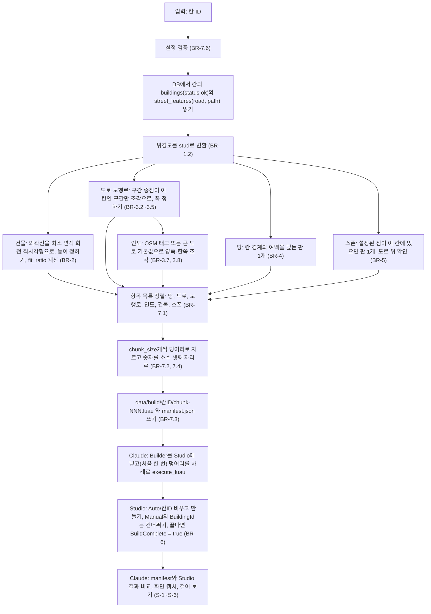

# U2 Studio 생성기 — Business Logic Model

## 흐름: 한 칸을 Studio에 만들기 (C6 `build_luau.py` + `studio/Builder.luau`)



텍스트 대안:

```text
DB(buildings, street_features) + 설정 -> [Python] stud 변환 -> 건물 박스 / 도로 조각 / 인도 조각 / 땅 / 스폰
  -> 정렬 -> 덩어리 -> chunk-NNN.luau + manifest.json
  -> [Claude가 Studio MCP로 실행] Auto/<칸ID>를 비우고 다시 만든다 (Manual은 읽기만)
  -> 만든 수와 manifest 비교, 캡처, 걸어 보기
```

## 단계별 입출력

| 단계 | 입력 | 출력 |
|---|---|---|
| 읽기 | 칸 ID, DB | 건물 행, 도로·보행로 행 |
| 변환 | 위경도, 원점, 스케일 | stud 좌표(x, z) |
| 건물 | 외곽선, 높이, 층수 | `building` 항목(박스, 높이, `yaw_deg`, 속성), `fit_ratio`, `poor_fit` |
| 도로·인도 | 줄 모양 요소, 폭 표, 태그, 칸 | `road`, `path`, `sidewalk` 항목 |
| 땅·스폰 | 칸 경계, 스폰 설정 | `ground`, `spawn` 항목, 경고 |
| 덩어리 | 정렬된 항목 목록 | 덩어리 파일, manifest |
| Studio 실행 | 덩어리 파일(코드) | `Workspace/Auto/<칸ID>`, 덩어리마다 만든 수 |
| 확인 | manifest, Studio의 부품 | 일치 여부, 캡처 |

## Studio 쪽 모듈 (`studio/Builder.luau`)의 역할
계산은 하지 않고 받은 값으로 부품을 만든다(BR-7.5). 필요한 동작은 세 가지다.

1. `begin(칸ID)`: `Workspace/Auto`, `Workspace/Manual`이 없으면 만들고, `Auto/<칸ID>`를 지운 뒤 하위 폴더를 만들고 `BuildComplete = false`로 둔다. `Manual` 안의 `BuildingId` 속성 값을 모아 둔다.
2. `add(칸ID, 항목들)`: 항목마다 부품을 만들어(건물이 수작업 우선이면 건너뛰고 센다) 종류에 맞는 폴더에 넣는다. 덩어리 하나를 컨테이너에 만든 뒤 한 번에 넣어서 Studio가 멈추는 것을 피한다.
3. `finish(칸ID)`: `BuildComplete = true`로 바꾸고 만든 수와 건너뛴 수를 돌려준다.

## 데이터 흐름

```text
buildings, street_features (U1, 읽기 전용) --> build_luau.py --> data/build/<칸ID>/ (git 제외)
                                                                  |
                                                  Claude --execute_luau--> Studio Workspace/Auto/<칸ID>
U4가 나중에 주는 것: 건물별 최종 층수·높이(BR-2.4의 입력을 바꾼다)
U5가 나중에 더하는 것: 지붕, 창문과 문, 간판, 가로시설, 학교 본관 수작업(Manual)
```

## 다른 유닛과의 약속
- **U1**: `buildings`, `street_features`를 읽기만 한다. 도로가 걸치는 모든 칸에 전체 모양으로 저장되어 있는 것을 BR-3.2(구간 중점 칸)로 받아서 한 번만 만든다.
- **U3**: 서로 의존하지 않는다. 건물 높이는 같은 규칙(BR-2.4)을 쓴다.
- **U4**: 건물 높이의 입력을 U4의 최종값으로 바꾼다. Studio에서 같이 확인하는 일(S4)은 이 유닛이 만든 부품의 `BuildingId`, `Floors`, `HeightM` 속성을 쓴다. 보정하려는 자동 건물은 `Manual`로 옮기고 속성 `BuildingId`를 유지한다(BR-2.8이 같은 ID의 자동 건물을 건너뛴다).
- **U5**: `Builder.luau`와 항목 종류를 늘린다. 안 맞는 건물(`poor_fit`)과 학교 본관은 `Manual`에서 수작업으로 만든다.

## 아직 모르는 것 (코드 생성과 NFR에서 확인)
- **Studio MCP 호출 한도:** `execute_luau`의 `code` 한 번에 덩어리 하나(항목 50개, 수십 KB)가 들어가는지, 호출 시간은 얼마인지. 안 되면 `chunk_size`를 줄인다(설정값).
- **ModuleScript에 소스 넣기:** `execute_luau`로 `ServerStorage/MapBuilder`의 `Source`를 쓸 수 있는지. 안 되면 덩어리 파일에 Builder 함수를 같이 넣는 방식으로 바꾼다(D-3의 대안).
- **회전 방향:** BR-1.4의 yaw 부호 가정(`CFrame.Angles(0, yaw, 0)`)이 맞는지(S-2에서 확인).
- **칸 하나의 부품 수와 걸을 때 성능:** 첫 칸의 예상 항목은 약 163개다(건물 122, 도로 29, 보행로 2, 인도 8, 땅 1, 스폰 1). 저장된 도로 구간 53개 중 31개만 이 칸의 몫이고 22개는 중점이 이웃 칸에 있다. 덩어리는 4개다. NFR-1(끊김 없이)은 NFR 단계에서 수치로 정한다.
- **스폰 점:** 정문 앞 도로의 좌표(Q6=B). 후보를 계산해 제안하고 Studio에서 같이 확정한다(코드 생성 뒤 첫 칸을 만든 다음).
- **스케일 3.6 stud/m이 맞는지:** 첫 칸을 만든 뒤 사용자와 같이 본다(FR-10).
