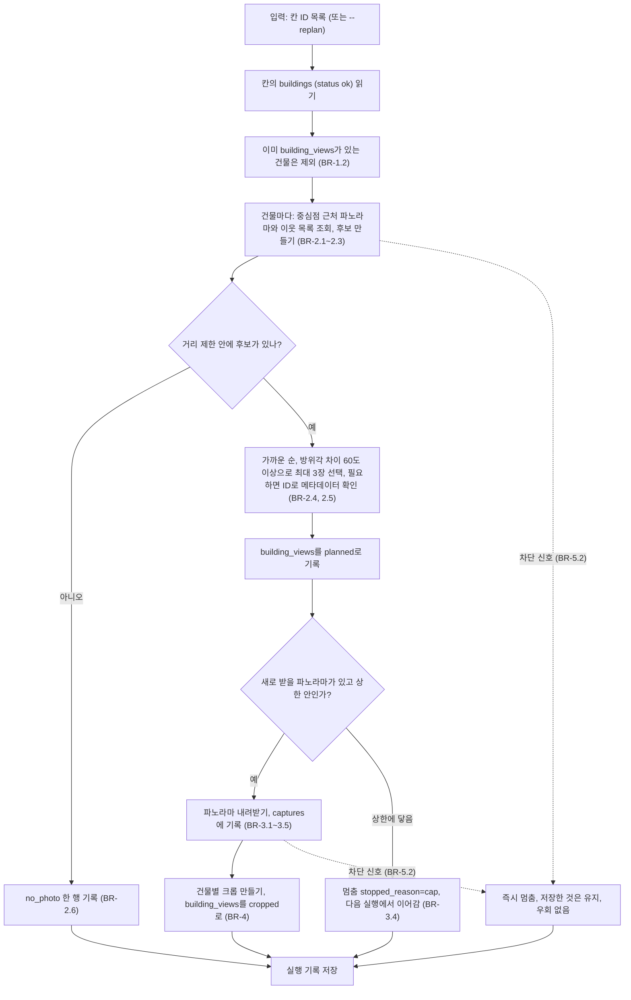

# U3 거리뷰 캡처 — Business Logic Model

## 흐름: 한 칸의 사진 수집 (C3 `capture.py`)



텍스트 대안:

```text
건물 -> 근처 파노라마 후보(거리 120m 안) -> 가까운 순, 방위각 60도 이상 차이로 최대 3장
     -> (없으면 no_photo) -> 파노라마 내려받기(상한 100장, 1초 간격) -> 건물 방향 크롭(60도~100도)
차단 신호가 나오면 어느 단계에서든 바로 멈춘다.
```

## 단계별 입출력

| 단계 | 입력 | 출력 |
|---|---|---|
| 후보 만들기 | 건물 중심점, 거리 제한 | Candidate 목록(ID, 위치, 거리, 방위각) |
| 선택 | Candidate 목록, `separation_deg`, `max_views` | 고른 파노라마 최대 3장 |
| 메타데이터 확인 | 파노라마 ID | 방향, 촬영일, 최신 여부, 해상도(조회 결과는 재사용) |
| 내려받기 | 선택된 파노라마 | 이미지 파일과 `meta.json`, `captures` 행 |
| 크롭 | 파노라마 이미지, 건물 외곽선과 높이 | 1024×768 JPEG, `building_views`의 `yaw`, `fov`, `pitch`, `crop_path` |

## 데이터 흐름

```text
buildings (U1) -> 후보 조회 -> building_views (planned) -> 다운로드 -> captures + captures/ 이미지
                                                       -> 크롭 -> building_views (cropped) + crops/ 이미지
U4가 읽는 것: building_views (건물별 최대 3장의 크롭 경로, no_photo 표시)
```

## 다른 유닛과의 약속
- U4는 `building_views`를 건물별로 읽는다. 크롭 경로가 있으면 그 사진으로 층수와 외관을 판단하고, `no_photo`이면 V-World 값과 사용자 확인으로 다룬다(설계 D-4).
- U2는 이 유닛에 의존하지 않는다.
- U3은 `buildings`의 외곽선, 중심점, 높이, 층수를 읽기만 하고 쓰지 않는다.

## 아직 모르는 것 (코드 생성에서 확인)
- **큐브 맵 면 순서와 정면 방향:** 6면 한 줄 이미지에서 어느 면이 앞, 오른쪽, 뒤, 왼쪽, 위, 아래인지, 그리고 파노라마의 heading이 앞면의 방향인지. 합성 이미지 테스트(P3-5)와 실제 건물을 향한 크롭을 눈으로 비교해서 확인한다.
- **차단 기준:** 네이버가 요청을 어떻게 제한하는지 알지 못한다. 호출 간격 1초가 충분한지는 실제 실행에서 확인한다. 막히면 우회하지 않고 멈춘다.
- **저장량:** 칸당 파노라마가 몇 장이 되고 몇 MB인지는 실제 칸에서 재어 본다(D-U3-11).
- **`pyexiv2` 의존성 문제:** 해결 방법은 NFR Requirements에서 정한다(D-U3-12).
- **라이브러리 안정성:** 네이버가 내부 통신을 바꾸면 깨질 수 있다. 그때 Playwright는 새 작업으로 시작한다(Q6=A).
