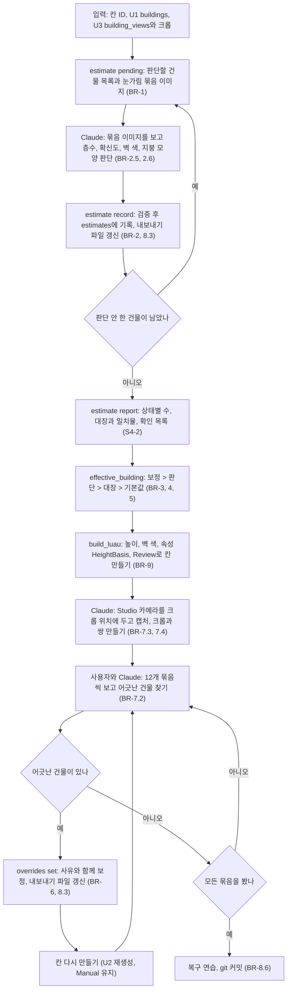
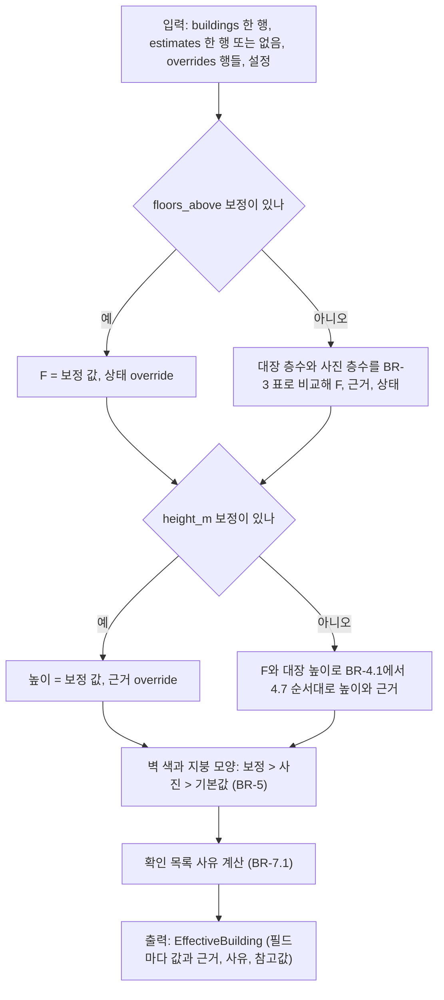
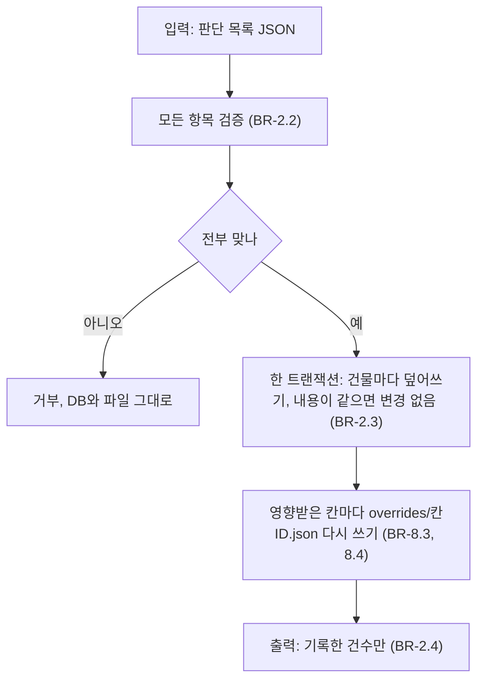

# U4 판단·보정 — Business Logic Model

## 흐름: 한 칸의 판단·보정 루프 (S4, S5)



텍스트 대안:

```text
pending(눈가림) -> Claude 판단 -> record -> estimates + 내보내기 파일
   ^                                          |
   +---- 남은 건물이 있으면 ------------------+
report(일치율, 확인 목록) -> effective_building -> build_luau -> Studio(Auto/칸ID)
   -> 카메라를 크롭 위치로 -> 캡처 + 크롭 = 비교 쌍 -> 사용자와 12개씩 확인
   -> 어긋남: overrides set -> 칸 다시 만들기 -> 다시 확인
   -> 끝: 복구 연습, 커밋
```

## 최종값 합치기 (C7 `effective_building`, 순수 함수)



## 한 판단 기록의 처리 (`record`)



## 단계별 입출력

| 단계 | 입력 | 출력 | 누가 |
|---|---|---|---|
| pending | 칸 ID | 판단할 건물 목록(눈가림)과 `captures/<칸ID>/sheets/*.jpg` | 스크립트 |
| 판단 | 묶음 이미지 | 건물별 층수, 확신도, 벽 색, 지붕 모양, 메모 | Claude |
| record | 판단 목록 | `estimates` 행, 내보내기 파일 | 스크립트 |
| report | 칸 ID | 상태별 수, 일치율, 확인 목록 | 스크립트 |
| 건설 | 칸 ID | Luau 덩어리(U2), Studio의 `Auto/<칸ID>` | 스크립트와 Claude |
| 비교 쌍 | `review.json`(카메라 값) | 캡처와 크롭의 쌍 | Claude(Studio)와 스크립트 |
| 확인 | 비교 쌍 12개 | 어긋난 건물 번호와 사용자 의견 | 사용자 |
| set / unset | 건물, 필드, 값, 사유 | `overrides` 행, 내보내기 파일 | 스크립트 |
| export / import | 칸 ID, 파일 | `overrides/<칸ID>.json` ↔ DB | 스크립트 |

## 상태 전이: 건물 하나의 층수 상태

```text
unjudged --record--> verified | unverified | changed | conflict | filled | none
                         (표 BR-3, 사진과 대장에 따라 정해진다)
어느 상태든 --set floors_above--> override
override --unset--> 위 상태 중 하나(보정이 없을 때의 계산 결과)
어느 상태든 --재판단(--redo) 또는 재수집--> 다시 계산 (상태는 저장하지 않고 매번 계산한다)
```

## 오류 처리

| 상황 | 처리 |
|---|---|
| 검증이 틀린 판단 또는 보정 | 호출 전체를 거부, DB와 파일 그대로, 어느 항목이 왜 틀렸는지 알린다 |
| 내보내기 파일 쓰기 실패 | DB 변경은 유지, 실패를 크게 알리고 다음 변경이나 `export`로 다시 쓴다 |
| 불러오기 파일이 틀림 | 아무것도 쓰지 않고 틀린 행을 알린다 |
| 건물 ID가 DB에 없는 보정 | `set`은 거부, `import`는 가져오되 고아로 알린다 |
| 사진 없는 건물 | 판단 목록에서 빼고 `no_photo` 목록으로 알린다. 판단 없이 대장 값, 없으면 기본값 |
| 크롭 파일이 없는데 DB에는 있음 | 묶음 이미지에서 그 칸을 비우고 경고한다. 크롭이 하나도 없으면 사진 없는 건물과 같이 다룬다 |
| Studio 카메라 캡처가 안 됨 | 비교 쌍을 "크롭과 건물 위 고정 각도 캡처"로 바꾸고 알린다(S4-3) |
| 판단과 대장이 많이 어긋나서 일치율이 낮음 | 숫자를 사용자에게 보이고, 대장이 없는 건물의 사진 값을 어떻게 다룰지 같이 정한다 |

## 알려진 한계

- 사진 판단은 나무·차에 가려진 건물에서 틀릴 수 있다. 확신도와 확인 목록, 사용자 확인이 안전장치다.
- 비교 쌍은 박스와 사진을 눈으로 대조하는 것이라 정확한 치수 검증이 아니다.
- 눈가림은 약속이다. Claude가 판단 도중 DB를 직접 열면 깨진다. 판단은 `pending` 출력과 묶음 이미지로만 한다.
