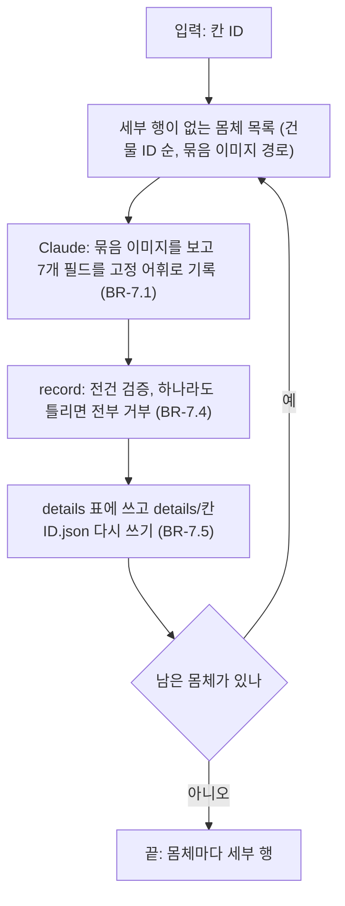
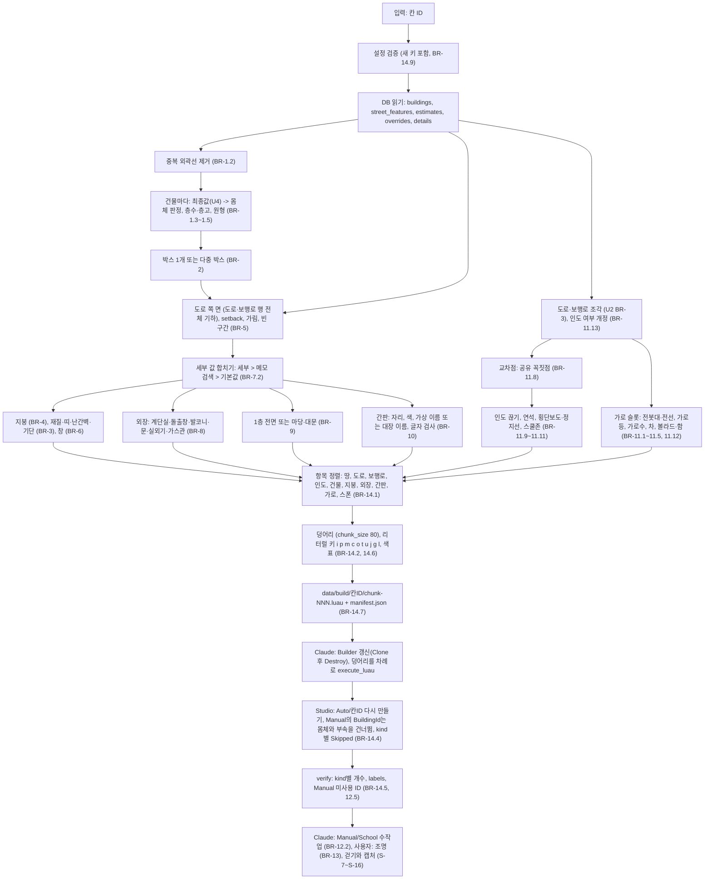

# U5 디테일 — Business Logic Model

## 흐름 1: 세부 판단 (C6 확장, `details.py`; Q1=A)



텍스트 대안:

```text
pending(칸) -> 세부 없는 몸체 + sheets 경로 -> Claude가 보고 기록 -> record(전건 검증, 원자성)
  -> details 표 + details/<칸ID>.json -> 남으면 반복
```

## 흐름 2: 한 칸을 Studio에 만들기 (C6 확장, `build_luau.py` + `layout.py` + `details_rules.py` + `Builder.luau`)



텍스트 대안:

```text
DB(buildings, street_features, estimates, overrides, details) + 설정
  -> 중복 제거 -> 몸체 판정·원형 -> 박스(들)
  -> 도로 조각 -> 교차점 -> 인도 끊기·연석·횡단보도·스쿨존 / 가로 슬롯(전봇대·전선·가로등·가로수·차·볼라드·함)
  -> 도로 쪽 면(행 전체 기하)·가림·빈 구간 -> 세부 합치기 -> 지붕 / 재질·띠·난간벽·기단 / 창 / 외장 / 1층·마당 / 간판
  -> 정렬 -> 덩어리 + 색표 -> chunk-NNN.luau + manifest
  -> [Claude가 Studio MCP로 실행] Auto/<칸ID> 다시 만들기 (Manual은 소유자 기준으로 건너뜀)
  -> verify -> Manual 학교 수작업, 조명, 걷기, 캡처, 복구 연습
```

## 단계별 입출력

| 단계 | 입력 | 출력 |
|---|---|---|
| 세부 판단 | 묶음 이미지, 몸체 목록 | `details` 행, `details/<칸ID>.json` |
| 중복 제거 | 칸의 건물 행 | 남긴 행, `duplicates_dropped` |
| 몸체·원형 | 행, 최종값, `school_polygons` | `is_body`, `F`, `fh`, 원형 |
| 박스 | 외곽선, fit | 박스 1~6개(이름, 소유자), `boxes`, `poor_fit` |
| 도로 쪽 면 | 박스, 도로·보행로 행 전체 기하, 인도 여부 | 면, `L`, `setback`, `setback_s`, 가려진 면 집합, 빈 구간, 앞 박스, `no_facing`, `far_facing` |
| 세부 합치기 | 세부 행, 메모, 벽 색, 원형 | `finish`, `ground_use`, `stair`, `bay`, `balcony`, `roof_color`, `rooftop` |
| 지붕·몸체 외관 | 박스, 최종값, 세부 | `roof`, `facade`(띠, 난간벽·난간, 기단, 창, 옥상) 항목 |
| 외장·1층·마당 | 앞 박스, 면, 빈 구간, 세부, 원형 | `facade` 항목(계단실, 돌출창, 발코니, 문, 캐노피, 실외기, 가스관, 전면, 처마), `prop` 항목(담, 되돌림, 기둥, 대문, 등, 관목) |
| 간판 | 앞 박스, 빈 구간, 원형, 층수, 이름, 해시 | `sign` 항목(글자, 배경·글자 색, 면), 글자 틀 기둥(`facade`) |
| 교차점·인도 | 피처 기하, 칸 | 교차점, 팔, 인도 조각, 연석, 횡단보도, 정지선, 스쿨존 울타리·기둥, 볼라드, 함 |
| 가로 슬롯 | 구간, 종류, 설정 | 전봇대·가로대·변압기·전선, 가로등, 가로수, 차 |
| 덩어리 | 정렬된 항목 | 덩어리 파일(색표 포함), manifest |
| Studio | 덩어리 파일 | `Auto/<칸ID>` 폴더 10개, `Skipped_<kind>`, verify 결과 |
| Manual | 학교 박스 좌표(scratch 계산) | `Manual/School` 부품 약 300~500 |

## 세부 판단 절차 (Claude용, BR-7)
1. `uv run src/details.py pending --cells <칸ID> --limit 10`: 세부 행이 없는 몸체가 건물 ID 순으로 나오고 묶음 이미지 경로(`captures/<칸ID>/sheets/<safe_name(건물 ID)>.jpg`, 예 `gis_11036833.jpg`; U4가 만든 것)가 붙는다. 없으면 U4의 `estimate.py pending`이 만드는 방식으로 다시 만든다.
2. 묶음 이미지를 읽고 7개 필드를 어휘대로 적는다. 안 보이면 비운다. 메모에는 사람·번호판·실제 상호를 쓰지 않는다.
3. `details.json`(목록)을 쓰고 `uv run src/details.py record --file details.json`. 하나라도 틀리면 전부 거부된다. 기록하면 `details/<칸ID>.json`이 갱신된다.
4. 남은 몸체가 0이 될 때까지 반복한다. 비운 필드는 메모 검색과 기본값이 채우므로 전부 적지 않아도 만들어진다.

## Studio 쪽 모듈 (`studio/Builder.luau`)의 역할
계산은 하지 않는다(U2 BR-7.5). 바뀌는 것:
1. `begin`: 폴더 10개와 `Skipped_<kind>` 속성.
2. `add`: 모양(`Shape`), 재질, 색표, 반사율, 소유자 판정과 건너뛰기, `BuildingId`를 소유자로, kind 기본과 `g`·`l`의 그림자·충돌, 세운 원통의 90° roll, 간판이면 `SurfaceGui` + `TextLabel`(`label.Text = it.t`; 양면이면 두 벌).
3. `finish`·`verify`: kind별 개수와 건너뛴 수, `labels`, manifest `building_ids`에 없는 Manual `BuildingId`.
`:Destroy()`는 U2의 한 곳뿐이고 `loadstring`·`HttpService`·디코더가 없다.

## 데이터 흐름

```text
captures/<칸ID>/sheets/ (U4, 로컬) --Claude--> details.py record --> details 표 --> details/<칸ID>.json (git)
buildings, street_features (U1) + estimates, overrides (U4) + details (U5) --> build_luau.py --> data/build/<칸ID>/ (git 제외)
data/build/<칸ID>/ --Claude, execute_luau--> Studio Workspace/Auto/<칸ID>
Claude --execute_luau (좌표는 scratch 계산, Manual/School 아래에만)--> Workspace/Manual/School   (원본은 .rbxl + Version History)
```

## 다른 유닛과의 약속
- **U1**: `buildings`, `street_features`를 읽기만 한다. 재수집은 `details`를 건드리지 않는다. `sidewalk:*` 태그를 읽는 것은 U2 규칙 개정이다.
- **U2**: `layout.py`·`build_luau.py`·`Builder.luau`를 확장한다. 개정: BR-3.6(인도 색), BR-3.7(residential 인도, `sidewalk:*`), BR-4.1(땅 색), BR-7.1(순서), BR-7.2(`chunk_size`). 바뀌지 않는 것: 원점·스케일, 박스 규칙(다중 박스는 fit < 0.8에서만), Manual 우선, `:Destroy()` 한 곳, 같은 결과. 컴포넌트 설명(application design C6)에 `details.py`·`details_rules.py`를 더하는 것은 코드 생성에서 적는다.
- **U3**: 묶음 이미지의 바탕인 크롭을 읽기만 한다. 새 사진은 찍지 않는다.
- **U4**: 최종값(`effective_building`)과 메모를 읽기만 한다. `estimates`·`overrides`·내보내기 v1은 바꾸지 않는다. 지붕 모양은 U4가 판단한 값을 그대로 쓴다.
- **다음 할 일**: 나머지 두 칸은 S1 → S3 → U4 판단 → U5 세부 판단 → 생성을 같은 흐름으로 반복하고, 3칸에서 FPS를 최종 확인한다.

## 아직 모르는 것 (NFR, 코드 생성, Build and Test에서 확인)
- **쐐기 축 규칙**은 S-7에서 맞았다(2026-10-13). 코드 생성 뒤 `Builder`로 다시 만든 것을 한 번 더 본다.
- **내장 재질의 타일 크기**(S-8: `Brick`은 맞았고 나머지는 첫 칸에서)와 **창 재질**(S-9: 불투명 `Glass` vs `SmoothPlastic`).
- **간판 글리프 비용**(S-10: 1장은 또렷했고 수백 장은 첫 칸에서)과 `MaxDistance` 값.
- **25 KB 이상 덩어리의 Studio 시간**(S-11)과 그에 따른 `chunk_size`.
- **첫 칸 약 6,000부품에서의 FPS**(S-13)와 3칸 외삽, `StreamingEnabled` 필요 여부.
- **세부 판단 116장에 드는 시간**: Functional Design 중에 93장까지 기록했다(건당 수십 초).
- **부흥중 필지 좌표**: V-World 연속지적도에서 받는다(코드 생성).
