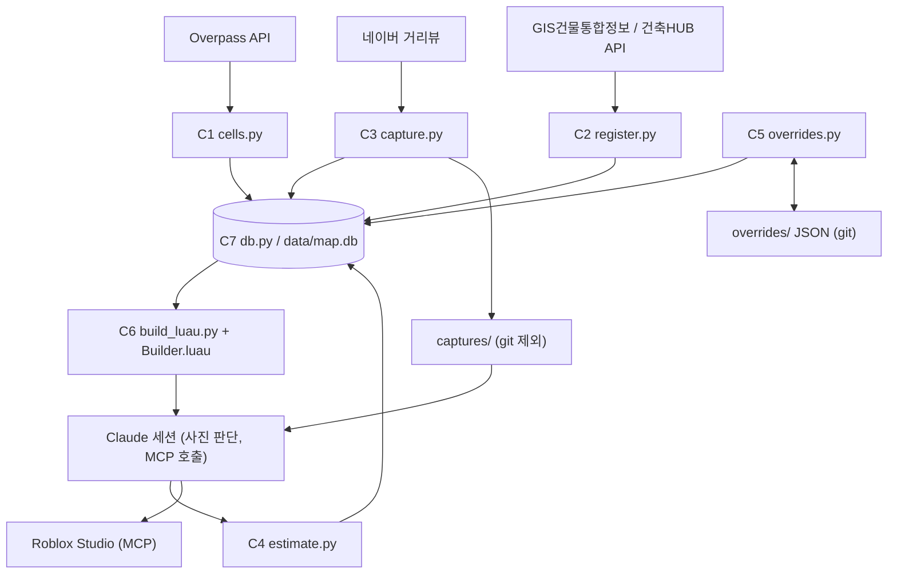

# Application Design — roblox-map (통합본)

아래 네 문서를 하나로 합친 것이다. 수정은 원본 문서에서 하고 이 문서는 다시 합쳐서 만든다.

## 확정한 설계 결정

| 질문 | 답 | 반영 |
|---|---|---|
| Q1 건물-대장 연결 | C GIS건물통합정보 도형을 OSM 건물과 겹침 매칭 | C2 |
| Q2 코드 구조 | A 역할별 스크립트 | C1~C7 |
| Q3 + Q7 데이터 | C SQLite 하나가 중심, `cells.py`도 DB에 쓴다 | C7 |
| Q4 Studio 생성 | B Studio에 ModuleScript를 넣고 데이터를 넘긴다 | C6 |
| Q5 레이어 | A `Workspace/Auto/<칸ID>` 와 `Workspace/Manual` | C6 |
| Q6 캡처 | C 칸마다 지점을 정해 360도 파노라마를 찍고 칸별로 저장·재사용 | C3 |
| Q8 DB 보호 | B DB는 git 제외, 보정 테이블만 JSON으로 내보내 git에 올린다 | C5 |

설계 기본값(사용자가 이의를 달지 않음): D-1 통합정보가 시험에서 안 되면 Q1을 다시 연다 / D-2 건축HUB API는 보조 / D-3 Luau 모듈 소스는 저장소의 `studio/` / D-4 사진 없는 건물은 대장 값과 사용자 확인 / D-5 사진은 `captures/<칸ID>/<지점ID>/`에 칸별 저장.

## Functional Design으로 넘기는 테스트 속성 후보 (PBT-01 준비)
- 좌표 변환(`to_studs`)과 역변환의 왕복이 오차 한계 안에서 같다
- 외곽선 → 박스: 박스가 외곽선 전체를 덮거나 면적 차이가 한계 안이다
- 칸 배정(`assign_cell`): 같은 건물은 항상 칸 하나에만 속한다
- 매칭(`match`): 대장 레코드 하나가 건물 둘 이상에 중복 배정되지 않는다
- 최종값 합치기(`effective_building`): 보정이 있으면 항상 보정이 이기고, 같은 입력은 같은 결과다
- 보정 내보내기·불러오기: 왕복하면 같은 값이다
- 높이 계산(`height_from_floors`): 층수에 대해 단조 증가한다


---

## 1. 컴포넌트

깊이: 최소. 컴포넌트 경계와 책임만 정한다. 규칙의 세부는 Functional Design에서 정한다.

결정 근거: Q1=C, Q2=A(역할별 스크립트), Q3=C+Q7=A(SQLite가 중심), Q4=B, Q5=A, Q6=C, Q8=B.

### 구성 원칙
- 역할마다 스크립트 하나. 각각 `uv run`으로 실행하고 의존성은 PEP 723 인라인에 버전을 고정한다(NFR-7).
- 스크립트끼리 직접 부르지 않는다. 데이터는 SQLite DB(`data/map.db`)로만 주고받는다.
- 모든 단계는 칸 단위로 다시 실행해도 같은 결과가 나온다(upsert). 수동 보정 테이블은 어떤 단계도 덮어쓰지 않는다(NFR-3, FR-11).

### 컴포넌트

#### C1. 칸 수집기 — `cells.py` (기존 스크립트 확장)
- **목적**: 구역 지정, H3 칸 채우기, OSM 데이터 수집
- **책임**:
  - 위경도 점들 또는 칸 ID 목록으로 H3 해상도 9 칸을 정한다(FR-1). 작은 부지는 칸 ID를 직접 준다
  - 칸마다 Overpass에서 건물 외곽선과 태그(높이, 층수, 용도)를 받아 원천 테이블 `osm_buildings`에 저장한다. 건물 소유 칸은 중심점(면적 무게중심)이 속한 칸 하나다(FR-2)
  - 칸마다 도로, 인도, 가로시설(나무, 가로등, 벤치, 횡단보도)을 받는다(FR-3)
  - 결과를 DB에 쓴다. 더 이상 `cells/*.json`을 만들지 않는다. 최종 `buildings`는 C2가 조립한다
  - Overpass 응답은 쓰기 전에 검증한다(NFR-7)
- **인터페이스**: 입력은 해상도와 위경도 점들(또는 칸 ID 목록), 출력은 DB의 `cells`, `osm_buildings`, `street_features`

#### C2. 건물 조립·속성 연결기 — `register.py`
- **목적**: OSM과 GIS건물통합정보로 칸의 최종 건물 목록을 조립하고 건축물대장 속성(층수, 높이, 용도)을 붙인다 (Q1=C, Q7=B)
- **책임**:
  - 칸 범위(버퍼 포함)의 GIS건물통합정보(건물 도형 + 대장 속성)를 `gis_buildings`에 받는다
  - 겹침 비율로 OSM과 GIS 건물을 이어 `buildings`를 조립한다: OSM 외곽선 우선, GIS 건물이 둘 이상 덮이면 GIS 외곽선으로 대체, OSM에 없는 GIS 건물은 독립 건물로 추가한다. 규칙은 U1 Business Rules 4장
  - 건축HUB API(`getBrTitleInfo`)는 통합정보에 없는 필드나 누락 건물을 메우는 보조로만 쓴다(D-2)
  - 응답을 검증하고 인증키는 환경변수로만 읽는다(NFR-7)
- **인터페이스**: 입력은 칸 ID, 출력은 DB의 `gis_buildings`, `buildings`, `register_matches`
- **전제**: GIS건물통합정보의 실제 조회 방법은 아직 확인하지 못했다. 안 되면 Q1을 다시 연다(D-1)

#### C3. 거리뷰 캡처기 — `capture.py`
- **목적**: 칸별로 거리뷰 360도 사진을 수집한다 (Q6=C, FR-8)
- **책임**:
  - 칸마다 캡처 지점을 몇 곳 정한다
  - 지점마다 360도 사진을 `captures/<칸ID>/<지점ID>/`에 저장한다(git 제외, D-5)
  - 요청 속도를 제한하고 CAPTCHA·봇 차단이 나오면 우회하지 않고 즉시 중단한다(NFR-5)
  - 지점 위치, 방향, 파일 경로를 DB의 `captures`에 기록한다
- **인터페이스**: 입력은 칸 ID, 출력은 사진 파일과 `captures` 레코드
- **한계**: 도로에서 안 보이는 부지 안쪽 건물은 사진이 없을 수 있다(D-4)

#### C4. 높이·외관 판단 — `estimate.py`
- **목적**: 건물별 층수, 높이, 외관 속성과 그 근거를 정한다 (FR-8, FR-9)
- **책임**:
  - 건물별로 층수를 정한다. 대장 값을 1순위로 쓰고 사진으로 검증한다. 대장에 없거나 어긋나는 건물만 거리뷰 기하 추정으로 채운다
  - 높이는 층수와 층고로 계산한다. OSM 태그는 참고로만 기록한다
  - 색, 지붕 형태 같은 외관 속성을 기록한다
  - 값마다 근거(대장, 사진 확인, 사진 추정, OSM 태그)와 사용한 사진을 남긴다
  - 사진을 보는 판단은 Claude가 Claude Code 세션에서 하고, 이 스크립트가 결과를 DB에 기록한다
- **인터페이스**: 입력은 칸 ID, 출력은 DB의 `estimates`. 판단이 필요한 건물 목록을 뽑는 명령과 판단을 기록하는 명령이 있다

#### C5. 보정 관리자 — `overrides.py`
- **목적**: 사용자와 Claude가 같이 확인해서 고친 값을 안전하게 보관한다 (FR-9, FR-11, Q8=B)
- **책임**:
  - 건물별 보정값과 사유를 DB의 `overrides`에 기록한다
  - `overrides`를 텍스트(JSON)로 내보내 `overrides/<칸ID>.json`에 둔다. 이 파일은 git에 올린다
  - 내보낸 파일에서 DB로 다시 불러온다. DB가 사라져도 보정값은 복구된다(NFR-6)
- **인터페이스**: `overrides` ↔ `overrides/<칸ID>.json`

#### C6. Studio 생성기 — `build_luau.py` + `studio/Builder.luau`
- **목적**: 칸 하나를 Studio에 건물 박스와 도로로 만든다 (FR-4, FR-10, FR-12, Q4=B, Q5=A)
- **책임**:
  - DB에서 건물별 최종값(기본값 ← 판단 ← 보정 순)을 읽는다
  - 위경도를 stud로 바꾸고(스케일은 설정값, FR-10) 외곽선을 박스로 단순화한다
  - 건물을 작은 덩어리로 나눠 `Builder.luau`에 넘길 데이터를 만든다
  - `studio/Builder.luau`는 저장소에 두고, Claude가 `execute_luau`로 Studio의 ModuleScript에 넣거나 갱신한다(D-3)
  - Studio 쪽은 `Workspace/Auto/<칸ID>` 폴더를 비우고 다시 만든다. `Workspace/Manual`은 건드리지 않는다
- **인터페이스**: 입력은 칸 ID와 덩어리 크기, 출력은 Luau 호출 데이터. 실행은 Claude가 Studio MCP로 한다

#### C7. 데이터 계층 — `db.py`
- **목적**: 모든 스크립트가 공유하는 SQLite 접근과 스키마
- **책임**:
  - 스키마 생성과 마이그레이션, 칸 단위 upsert
  - 건물별 최종값을 합치는 함수(보정 > 판단 > 대장 > 기본값, 순서 세부는 Functional Design)
  - 보정 테이블은 다른 테이블 재생성과 분리해서 다룬다
- **주요 테이블**: `cells`, `osm_buildings`, `gis_buildings`, `buildings`, `street_features`, `register_matches`, `collection_runs`, `captures`, `estimates`, `overrides` (U1 테이블 정의는 `construction/u1-data-foundation/functional-design/domain-entities.md`)
- **파일 위치**: `data/map.db`(git 제외)

### Studio 쪽 구조 (Q5=A)

```text
Workspace
  Auto/<칸ID>   스크립트가 만든 건물, 재생성하면 이 폴더만 비우고 다시 만든다
  Manual        직접 만든 건물과 고친 건물, 재생성이 건드리지 않는다
```
자동 건물을 직접 고치려면 `Manual`로 옮기고 해당 건물의 보정은 `overrides`에 사유와 함께 남긴다.

### 파일 위치 요약

| 경로 | 내용 | git |
|---|---|---|
| `data/map.db` | SQLite 중심 데이터 | 제외 |
| `overrides/<칸ID>.json` | 수동 보정 내보내기 | 포함 |
| `captures/<칸ID>/<지점ID>/` | 거리뷰 사진 | 제외 |
| `studio/Builder.luau` | Studio 생성 모듈 소스 | 포함 |
| `.env` | 인증키(`DATA_GO_KR_KEY`) | 제외 |
| `src/cells.py`, `src/register.py`, `src/capture.py`, `src/estimate.py`, `src/overrides.py`, `src/build_luau.py`, `src/db.py` | 스크립트 | 포함 |

---

## 2. 컴포넌트 메서드

메서드 시그니처와 목적만 적는다. 규칙의 세부(수식, 임계값, 순서)는 Functional Design에서 정한다.

타입은 Python 표기(PEP 604)를 쓴다. `CellId`는 H3 칸 ID 문자열, `BuildingId`는 OSM 건물 ID에 칸 ID를 붙인 문자열이다.

### C7. 데이터 계층 (`db.py`)

| 메서드 | 입력 → 출력 | 목적 |
|---|---|---|
| `connect(path="data/map.db") -> Connection` | 경로 → 연결 | 연결하고 스키마가 없으면 만든다 |
| `upsert_cell(conn, cell: Cell) -> None` | 칸 → 없음 | 칸을 같은 ID로 덮어쓴다 |
| `replace_cell_rows(conn, cell_id: CellId, tables: dict[str, list[Row]]) -> int` | 칸 ID, 테이블별 행 → 저장 개수 | 한 트랜잭션에서 그 칸 소유 원천 행을 지우고 새로 넣는다. `estimates`, `overrides`는 건드리지 않는다 |
| `orphans(conn) -> list[Orphan]` | 없음 → 고아 목록 | `buildings`에 없는 `building_id`를 가진 `overrides`, `estimates`를 찾는다(대체된 건물이면 새 ID도 알려 준다) |
| `effective_building(conn, building_id: BuildingId) -> EffectiveBuilding` | 건물 ID → 최종값 | 보정 > 판단 > 대장 > 기본값 순으로 합쳐 층수, 높이, 외관, 근거를 돌려준다 |
| `effective_buildings(conn, cell_id: CellId) -> list[EffectiveBuilding]` | 칸 ID → 최종값 목록 | 칸 단위 조회 |

### C1. 칸 수집기 (`cells.py`)

| 메서드 | 입력 → 출력 | 목적 |
|---|---|---|
| `fill_cells(points: list[LatLon], res: int) -> list[CellId]` | 점들, 해상도 → 칸 목록 | 다각형을 H3 칸으로 채운다. 칸 ID를 직접 주는 경로도 있다 |
| `fetch_osm_buildings(cell_id: CellId, buffer_m: float) -> list[OsmBuilding]` | 칸 ID, 버퍼 → OSM 건물 | 버퍼를 포함한 범위의 건물 외곽선과 태그를 받고 응답을 검증한다 |
| `centroid(outline: list[LatLon]) -> LatLon` | 외곽선 → 면적 무게중심 | 면적이 0이면 꼭짓점 평균으로 대신한다 |
| `assign_cell(centroid: LatLon, res: int) -> CellId` | 중심점 → 칸 ID | 건물을 중심점이 속한 칸에만 배정한다 |
| `normalize_height(raw: str \| None) -> float \| None` / `normalize_levels(raw: str \| None) -> int \| None` | 태그 문자열 → 값 | 숫자로 읽히지 않거나 0 이하이면 없음으로 본다 |
| `is_valid_outline(outline: list[LatLon]) -> bool` | 외곽선 → 유효 여부 | 점 3개 미만, 면적 0, 자기 교차를 걸러낸다 |
| `fetch_street_features(cell_id: CellId) -> list[StreetFeature]` | 칸 ID → 도로·가로시설 | 도로, 보행로, 횡단보도, 그리고 OSM에 있는 나무·가로등·벤치를 받는다. 도로 폭은 정하지 않는다 |
| `run(res: int, points: list[LatLon] \| None, cells: list[CellId] \| None) -> None` | 입력 → 없음 | 위를 순서대로 실행해 DB에 쓴다(명령줄 진입점) |

### C2. 건물 조립·속성 연결기 (`register.py`)

| 메서드 | 입력 → 출력 | 목적 |
|---|---|---|
| `fetch_integrated(cell_id: CellId, buffer_m: float) -> list[GisBuilding]` | 칸 ID, 버퍼 → 대장 속성이 붙은 건물 도형 | GIS건물통합정보에서 가져오고 응답을 검증한다. 접근 불가면 `None`을 돌려주고 OSM만으로 조립한다 |
| `overlap_ratio(a: Outline, b: Outline) -> float` | 두 외곽선 → 0~1 | 겹치는 면적 ÷ 작은 쪽 면적 |
| `assemble(osm: list[OsmBuilding], gis: list[GisBuilding] \| None) -> Assembly` | 두 목록 → 건물 목록과 속성 연결 | OSM 우선, GIS 둘 이상이 덮이면 GIS로 대체, 겹치지 않는 GIS는 독립 건물로 추가한다(U1 Business Rules 4장) |
| `fetch_title_info(plat: PlatKey) -> RegisterRecord \| None` | 법정동코드와 번지 → 대장 | 건축HUB API로 누락이나 빈 필드를 메운다. 키는 환경변수, 호출 상한이 있다 |
| `run(cell_id: CellId) -> None` | 칸 ID → 없음 | 가져오기, 조립, 보조 조회, DB 저장을 한다 |

### C3. 거리뷰 캡처기 (`capture.py`)

| 메서드 | 입력 → 출력 | 목적 |
|---|---|---|
| `plan_points(cell_id: CellId) -> list[CapturePoint]` | 칸 ID → 캡처 지점 | 칸마다 지점을 몇 곳 정한다 |
| `capture_point(point: CapturePoint) -> list[Path]` | 지점 → 사진 경로 | 360도 사진을 저장한다. 속도를 제한하고 CAPTCHA·차단이 나오면 `BlockedError`를 내고 중단한다 |
| `run(cell_id: CellId) -> None` | 칸 ID → 없음 | 지점 계획, 캡처, `captures` 기록을 순서대로 한다 |

### C4. 높이·외관 판단 (`estimate.py`)

| 메서드 | 입력 → 출력 | 목적 |
|---|---|---|
| `pending(cell_id: CellId) -> list[PendingItem]` | 칸 ID → 판단 대기 건물 | 대장 값이 없거나 사진과 검증이 안 된 건물을 뽑는다 |
| `record(building_id: BuildingId, judgement: Judgement) -> None` | 건물 ID, 판단 → 없음 | 층수, 외관, 근거, 사용한 사진을 `estimates`에 쓴다 |
| `height_from_floors(floors: int, use: str) -> float` | 층수, 용도 → 높이(m) | 층수에 층고를 곱해 높이를 만든다(층고 규칙은 Functional Design) |

### C5. 보정 관리자 (`overrides.py`)

| 메서드 | 입력 → 출력 | 목적 |
|---|---|---|
| `set_override(building_id: BuildingId, field: str, value: Any, reason: str) -> None` | 건물, 필드, 값, 사유 → 없음 | 보정값을 `overrides`에 기록한다 |
| `export_overrides(cell_id: CellId, path: Path) -> None` | 칸 ID, 경로 → 없음 | 보정값을 JSON으로 내보낸다 |
| `import_overrides(path: Path) -> int` | 경로 → 불러온 개수 | JSON에서 DB로 복구한다 |

### C6. Studio 생성기 (`build_luau.py`, `studio/Builder.luau`)

| 메서드 | 입력 → 출력 | 목적 |
|---|---|---|
| `to_studs(point: LatLon, origin: LatLon, scale: float) -> Vec2` | 위경도, 기준점, 스케일 → stud 좌표 | 좌표를 변환한다(FR-10) |
| `outline_to_box(outline: list[LatLon]) -> Box` | 외곽선 → 박스 | 외곽선을 단순화한 박스로 바꾼다 |
| `chunks(cell_id: CellId, size: int) -> Iterator[ChunkData]` | 칸 ID, 덩어리 크기 → 덩어리 | 건물을 작은 덩어리로 나눠 Luau에 넘길 데이터를 만든다 |
| `Builder.buildChunk(cellId, chunk) -> number` (Luau) | 칸 ID, 덩어리 → 만든 개수 | `Workspace/Auto/<칸ID>`에 건물을 만든다 |
| `Builder.clearCell(cellId) -> ()` (Luau) | 칸 ID → 없음 | `Auto/<칸ID>`만 비운다. `Manual`은 건드리지 않는다 |

---

## 3. 서비스(작업 흐름)

별도 서버나 상시 실행 서비스는 없다. 여기서 서비스는 "칸 하나를 처리하는 작업 흐름"이다. 오케스트레이터 스크립트는 만들지 않고, 순서는 이 문서와 Claude의 작업 흐름이 정한다(Q2=A). 단계가 늘어 손이 많이 가면 그때 얇은 실행 스크립트를 추가한다.

### 서비스 정의

#### S1. 구역 준비
- **책임**: 구역 지정, 칸 목록, 건물과 도로 수집, 대장 속성 연결
- **순서**: `cells.py` → `register.py`
- **결과**: DB에 칸, 건물, 가로시설, 대장 매칭이 있다
- **실행 시점**: 칸마다 처음 한 번. 필요하면 다시 실행해도 된다(upsert)

#### S2. 칸 건설
- **책임**: DB의 최종값으로 Studio에 칸을 만든다
- **순서**: Claude가 `Builder.luau`를 Studio에 넣거나 갱신 → `build_luau.py`로 덩어리 생성 → Claude가 `execute_luau`로 `clearCell` 후 `buildChunk`를 덩어리마다 실행 → `screen_capture`로 확인
- **결과**: `Workspace/Auto/<칸ID>`에 건물과 도로가 있다. `Manual`은 그대로
- **주의**: `execute_luau`는 실행 중 Studio가 멈추므로 덩어리를 작게 나눈다. 큰 작업 전에는 `.rbxl` 복사본을 만든다(NFR-6)

#### S3. 사진 수집
- **책임**: 칸별 거리뷰 360도 사진 수집
- **순서**: `capture.py`
- **결과**: `captures/<칸ID>/<지점ID>/`에 사진, DB에 `captures` 기록
- **정지 조건**: CAPTCHA나 봇 차단이 나오면 우회하지 않고 즉시 멈춘다. 이후 진행은 사용자 판단

#### S4. 판단·보정 루프
- **책임**: 높이와 외관을 정하고 사용자와 Claude가 같이 확인해서 보정한다
- **순서**:
  1. `estimate.py pending`으로 대기 건물 확인
  2. Claude가 사진을 보고 층수·외관을 판단해 `estimate.py record`로 기록
  3. S2로 다시 만든 뒤 Studio 캡처와 거리뷰 사진을 비교한다
  4. 사용자와 Claude가 같이 보고 어긋난 건물을 `overrides.py set`으로 보정한다
  5. 만족할 때까지 3~4를 반복한다
- **결과**: 건물마다 근거가 남은 최종 높이와 외관

#### S5. 보호
- **책임**: 재생성이 안 되는 값을 지킨다(NFR-6, RPO 수 시간)
- **순서**: `overrides.py export`로 `overrides/<칸ID>.json` 갱신 → git 커밋. 큰 작업 전 `.rbxl` 복사, Studio 클라우드 저장
- **복구**: 새 DB에 S1을 다시 돌리고 `overrides.py import`로 보정값을 불러온다. 사진은 로컬 파일이라 `captures/`가 사라지면 다시 찍어야 한다

### 칸 하나의 전체 흐름

```text
S1 구역 준비 -> S3 사진 수집 -> S4 판단(1~2) -> S2 칸 건설 -> S4 비교와 보정(3~5)
                                                       ^                    |
                                                       +---- 다시 건설 -------+
S5 보호는 보정이 쌓일 때마다 실행
```

### 재실행 규칙 (NFR-3)
- S1, S2, S3, S4의 1~2단계는 칸 단위로 다시 실행할 수 있고 같은 입력이면 같은 결과가 나온다
- 재실행이 지우거나 덮어쓰는 것은 그 단계가 만든 데이터뿐이다. `overrides`와 Studio의 `Manual`은 어떤 재실행도 건드리지 않는다

---

## 4. 의존 관계

### 의존 매트릭스

행이 열을 사용한다. 컴포넌트끼리는 직접 부르지 않고 DB를 통해서만 이어진다.

| 사용하는 쪽 \ 사용되는 쪽 | C7 데이터 계층 | 외부 |
|---|---|---|
| C1 칸 수집기 | 쓰기 (`cells`, `osm_buildings`, `street_features`) | Overpass API |
| C2 조립·속성 연결기 | 읽기 (`osm_buildings`), 쓰기 (`gis_buildings`, `buildings`, `register_matches`) | GIS건물통합정보, 건축HUB API |
| C3 캡처기 | 읽기 (`cells`, `buildings`), 쓰기 (`captures`) | 네이버 거리뷰 (Playwright) |
| C4 판단 | 읽기 (`buildings`, `register_matches`, `captures`), 쓰기 (`estimates`) | 없음 (사진은 Claude가 본다) |
| C5 보정 관리자 | 읽기·쓰기 (`overrides`) | `overrides/<칸ID>.json` 파일 |
| C6 Studio 생성기 | 읽기 (최종값 `effective_buildings`, `street_features`) | Studio MCP (Claude 경유) |

### 의존 관계 그림



텍스트 대안:

```text
Overpass -> C1 -> DB
GIS건물통합정보/건축HUB -> C2 -> DB
네이버 거리뷰 -> C3 -> DB + captures/
captures/ -> Claude(사진 판단) -> C4 -> DB
C5 <-> DB, C5 <-> overrides/*.json (git)
DB -> C6 -> Claude -> Studio MCP -> Workspace/Auto, Workspace/Manual
```

### 통신 방식
- 스크립트 ↔ DB: SQLite 직접 접근(`db.py`를 import). 칸 단위 트랜잭션
- 스크립트 ↔ 외부 API: HTTPS. 응답을 검증한 뒤에만 DB에 쓴다
- Claude ↔ Studio: Studio MCP(`execute_luau`, `screen_capture`). Python은 MCP를 직접 호출하지 못한다
- Claude ↔ 사진: 파일을 읽는다. 판단 결과는 `estimate.py`가 DB에 기록한다

### 실행 순서 의존

```text
C1 -> C2 -> C3 -> C4(판단) -> C6 -> C4/C5(비교와 보정) -> C6 ...
```
- C2는 C1이 쓴 `buildings`가 있어야 한다
- C3은 `buildings`가 있어야 지점을 계획할 수 있다
- C4는 `register_matches`와 `captures`가 있으면 더 정확하다. 없으면 판단 대기로 남는다
- C6은 `buildings`만 있어도 박스를 만들 수 있다(층수는 기본값). 판단과 보정이 쌓일수록 정확해진다

### 순환 의존 점검
컴포넌트 사이에 직접 의존이 없고 모두 C7(DB)만 향하므로 순환이 없다. C6 → Claude → C4 경로는 사람이 개입하는 반복 흐름이지 코드 의존이 아니다.
