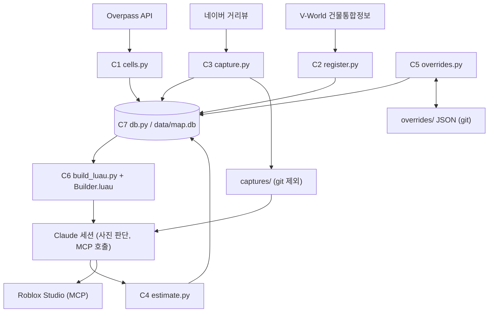

# Component Dependencies

## 의존 매트릭스

행이 열을 사용한다. 컴포넌트끼리는 직접 부르지 않고 DB를 통해서만 이어진다.

| 사용하는 쪽 \ 사용되는 쪽 | C7 데이터 계층 | 외부 |
|---|---|---|
| C1 칸 수집기 | 쓰기 (`cells`, `osm_buildings`, `street_features`) | Overpass API |
| C2 건물 조립기 | 읽기 (`osm_buildings`), 쓰기 (`gis_buildings`, `buildings`) | V-World 건물통합정보 |
| C3 캡처기 | 읽기 (`cells`, `buildings`), 쓰기 (`captures`, `building_views`) | 네이버 거리뷰 (`streetlevel` 라이브러리) |
| C4 판단 | 읽기 (`buildings`, `captures`), 쓰기 (`estimates`) | 없음 (사진은 Claude가 본다) |
| C5 보정 관리자 | 읽기·쓰기 (`overrides`) | `overrides/<칸ID>.json` 파일 |
| C6 Studio 생성기 | 읽기 (최종값 `effective_buildings`, `street_features`) | Studio MCP (Claude 경유) |

## 의존 관계 그림



텍스트 대안:

```text
Overpass -> C1 -> DB
V-World 건물통합정보 -> C2 -> DB
네이버 거리뷰 -> C3 -> DB + captures/
captures/ -> Claude(사진 판단) -> C4 -> DB
C5 <-> DB, C5 <-> overrides/*.json (git)
DB -> C6 -> Claude -> Studio MCP -> Workspace/Auto, Workspace/Manual
```

## 통신 방식
- 스크립트 ↔ DB: SQLite 직접 접근(`db.py`를 import). 칸 단위 트랜잭션
- 스크립트 ↔ 외부 API: HTTPS. 응답을 검증한 뒤에만 DB에 쓴다
- Claude ↔ Studio: Studio MCP(`execute_luau`, `screen_capture`). Python은 MCP를 직접 호출하지 못한다
- Claude ↔ 사진: 파일을 읽는다. 판단 결과는 `estimate.py`가 DB에 기록한다

## 실행 순서 의존

```text
C1 -> C2 -> C3 -> C4(판단) -> C6 -> C4/C5(비교와 보정) -> C6 ...
```
- C2는 C1이 쓴 `buildings`가 있어야 한다
- C3은 `buildings`가 있어야 지점을 계획할 수 있다
- C4는 `buildings`(V-World 층수·높이 포함)와 `captures`가 있으면 더 정확하다. 없으면 판단 대기로 남는다
- C6은 `buildings`만 있어도 박스를 만들 수 있다(층수는 기본값). 판단과 보정이 쌓일수록 정확해진다

## 순환 의존 점검
컴포넌트 사이에 직접 의존이 없고 모두 C7(DB)만 향하므로 순환이 없다. C6 → Claude → C4 경로는 사람이 개입하는 반복 흐름이지 코드 의존이 아니다.
