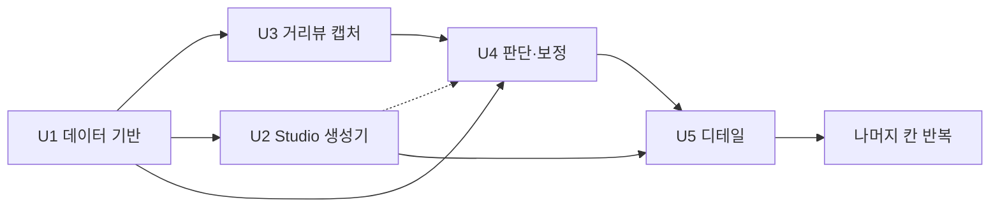

# Unit of Work Dependencies

## 의존 매트릭스

행이 열에 의존한다. `●`는 코드나 데이터 의존, `○`는 확인·시험에 필요한 소프트 의존.

| 유닛 \ 의존 대상 | U1 | U3 | U2 | U4 | U5 |
|---|---|---|---|---|---|
| U1 데이터 기반 | - | | | | |
| U3 거리뷰 캡처 | ● `buildings` | - | | | |
| U2 Studio 생성기 | ● `buildings`, `street_features` | | - | | |
| U4 판단·보정 | ● `buildings`(V-World 층수·높이) | ● `captures` | ○ Studio에서 확인 | - | |
| U5 디테일 | | | ● `Builder.luau` | ● 최종값 | - |

- U3과 U2는 서로 의존하지 않는다. 진행 순서가 U3 → U2인 것은 위험 기준이다.
- 순환 의존은 없다.

## 의존 그림



텍스트 대안:

```text
U1 -> U3, U2, U4
U3 -> U4
U2 -.(확인용).-> U4
U2 -> U5, U4 -> U5
U5 -> 나머지 칸 반복
```

## 진행 순서와 이유

| 순서 | 유닛 | 이유 |
|---|---|---|
| 1 | U1 | 모든 유닛이 DB와 건물 데이터를 쓴다. V-World 시험이 끝나서 설계 불확실성이 줄었다 |
| 2 | U3 | 거리뷰 캡처가 가장 불확실하다. 안 되면 U4의 판단 방식을 바꿔야 해서 일찍 알아야 한다 |
| 3 | U2 | 박스가 서야 스케일(FR-10)과 걸어 다니는 느낌을 확인할 수 있다 |
| 4 | U4 | 사진, 대장, Studio 결과가 모두 있어야 비교하고 보정할 수 있다 |
| 5 | U5 | 높이와 외관이 안정된 뒤에 지붕·창문·간판을 얹는다 |

## 실패 시 되돌아가는 지점

| 상황 | 영향 | 대응 |
|---|---|---|
| U1에서 V-World 호출 실패(키 만료, 서비스 장애) | U1 중단 | 키와 서비스 상태를 확인하고 재시도한다. 시험 호출은 2026-10-13에 성공했다 |
| U3에서 거리뷰 캡처 불가 또는 차단 | U4가 대장 값과 수동 확인에 의존 | 우회하지 않고 멈춘 뒤 사용자와 방법 재결정 (사진 없는 건물과 같은 처리, D-4) |
| U2에서 스케일 부적합 | U5 이후 수치 변경 | 스케일은 설정값이라 U2 안에서 조정 |

## 공유 자원
- `data/map.db`: 모든 유닛이 읽고 쓴다. 유닛마다 자기 테이블만 쓴다.
- `.env`: U1(V-World 키)만 쓴다. 데이터 포털 키는 보관만 한다.
- Studio 열린 장소: U2, U4, U5가 쓴다. 큰 작업 전에는 `.rbxl` 복사본을 만든다.
- `captures/`: U3이 쓰고 U4가 읽는다.
