# Execution Plan — roblox-map

## Detailed Analysis Summary

### Transformation Scope (Brownfield Only)
- **Transformation Type**: 새 기능 추가 (기존 `cells.py` 프로토타입은 그대로 두고 그 위에 쌓는다)
- **Primary Changes**: Roblox 생성기, 거리뷰 캡처·높이 추정, 도로·가로시설과 건축물대장(층수) 수집, 자동·수작업 레이어 분리
- **Related Components**: `cells.py` (H3 칸 채우기 + OSM 건물 수집), `cells/*.json` (생성 데이터, git 제외)

### Change Impact Assessment
- **User-facing changes**: Yes. 걸어 다닐 수 있는 Roblox 맵이 결과물이다. 사용자는 본인 하나다
- **Structural changes**: Yes. 단일 스크립트에서 수집, 캡처, 추정, 생성 컴포넌트로 나뉜다
- **Data model changes**: Yes. 칸 JSON에 건물별 높이 근거(거리뷰 추정, OSM 태그, 수동 보정)와 외관 속성이 늘어난다
- **API changes**: No. 외부 공개 API는 없다. Overpass, Studio MCP, 네이버 거리뷰를 소비만 한다
- **NFR impact**: Yes. 캡처 속도 제한과 차단 시 중단(NFR-4, NFR-5), 의존성 버전 고정(NFR-7), 속성 기반 테스트(NFR-8), 백업(NFR-6), 3칸 규모 걸어 다니기 성능(NFR-1)

### Component Relationships (Brownfield Only)

```text
cells.py (H3 칸, OSM 건물) --> cells/<칸ID>.json --> [거리뷰 캡처] --> [높이·외관 추정]
                                      |                                      |
                                      +-----------> [Studio 생성기] <--------+
                                                          |
                                         Studio MCP (execute_luau, screen_capture)
                                                          |
                                      자동 레이어 / 수작업 레이어 (FR-11)
```

| 컴포넌트 | 변경 종류 | 이유 | 우선순위 |
|---|---|---|---|
| `cells.py` | Minor | 도로, 인도, 가로시설 수집과 건축물대장 층수 수집·연결 추가 (FR-2, FR-3, FR-9) | Important |
| Studio 생성기 (신규) | Major | 좌표 변환, 박스 생성, 레이어 분리 (FR-4, 10, 11, 12) | Critical |
| 거리뷰 캡처 (신규) | Major | Playwright 360도 캡처, 속도 제한, 차단 시 중단 (FR-8, NFR-5) | Critical |
| 높이·외관 추정 (신규) | Major | 거리뷰로 높이·색·지붕 판단, 근거 기록 (FR-8, 9) | Critical |

### Risk Assessment
- **Risk Level**: Medium. 네이버 약관은 확인하지 않기로 했고 자동 캡처가 차단될 가능성이 있다, 거리뷰 기반 높이 추정의 정확도가 불확실하다. 건축물대장 API의 필드와 OSM 건물 연결 방법도 미확인이다(A-7). 다만 대장 값을 쓰면 거리뷰 추정 의존도가 줄어든다
- **Rollback Complexity**: Easy. 스크립트는 Git, 맵은 Studio Version History와 `.rbxl` 복사본으로 되돌린다. 데이터는 재생성 가능
- **Testing Complexity**: Moderate. 순수 함수는 속성 기반 테스트로, 맵 결과는 사용자와 Claude가 Studio에서 같이 확인한다

## Workflow Visualization

```mermaid
flowchart TD
    Start(["User Request"])

    subgraph INCEPTION["INCEPTION PHASE"]
        WD["Workspace Detection<br/><b>COMPLETED</b>"]
        RE["Reverse Engineering<br/><b>SKIP</b>"]
        RA["Requirements Analysis<br/><b>COMPLETED</b>"]
        US["User Stories<br/><b>SKIP</b>"]
        WP["Workflow Planning<br/><b>IN PROGRESS</b>"]
        AD["Application Design<br/><b>EXECUTE</b>"]
        UG["Units Generation<br/><b>EXECUTE</b>"]
    end

    subgraph CONSTRUCTION["CONSTRUCTION PHASE"]
        FD["Functional Design<br/><b>EXECUTE</b>"]
        NFRA["NFR Requirements<br/><b>EXECUTE</b>"]
        NFRD["NFR Design<br/><b>EXECUTE</b>"]
        ID["Infrastructure Design<br/><b>SKIP</b>"]
        CG["Code Generation<br/><b>EXECUTE</b>"]
        BT["Build and Test<br/><b>EXECUTE</b>"]
    end

    subgraph OPERATIONS["OPERATIONS PHASE"]
        OPS["Operations<br/><b>PLACEHOLDER</b>"]
    end

    Start --> WD
    WD --> RE
    RE --> RA
    RA --> US
    US --> WP
    WP --> AD
    AD --> UG
    UG --> FD
    FD --> NFRA
    NFRA --> NFRD
    NFRD --> ID
    ID --> CG
    CG --> BT
    BT --> OPS
    OPS --> End(["Complete"])

    style WD fill:#4CAF50,stroke:#1B5E20,stroke-width:3px,color:#fff
    style RA fill:#4CAF50,stroke:#1B5E20,stroke-width:3px,color:#fff
    style WP fill:#4CAF50,stroke:#1B5E20,stroke-width:3px,color:#fff
    style CG fill:#4CAF50,stroke:#1B5E20,stroke-width:3px,color:#fff
    style BT fill:#4CAF50,stroke:#1B5E20,stroke-width:3px,color:#fff
    style RE fill:#BDBDBD,stroke:#424242,stroke-width:2px,stroke-dasharray: 5 5,color:#000
    style US fill:#BDBDBD,stroke:#424242,stroke-width:2px,stroke-dasharray: 5 5,color:#000
    style ID fill:#BDBDBD,stroke:#424242,stroke-width:2px,stroke-dasharray: 5 5,color:#000
    style AD fill:#FFA726,stroke:#E65100,stroke-width:3px,stroke-dasharray: 5 5,color:#000
    style UG fill:#FFA726,stroke:#E65100,stroke-width:3px,stroke-dasharray: 5 5,color:#000
    style FD fill:#FFA726,stroke:#E65100,stroke-width:3px,stroke-dasharray: 5 5,color:#000
    style NFRA fill:#FFA726,stroke:#E65100,stroke-width:3px,stroke-dasharray: 5 5,color:#000
    style NFRD fill:#FFA726,stroke:#E65100,stroke-width:3px,stroke-dasharray: 5 5,color:#000
    style OPS fill:#FFF59D,stroke:#F57F17,stroke-width:2px,color:#000
    style Start fill:#CE93D8,stroke:#6A1B9A,stroke-width:3px,color:#000
    style End fill:#CE93D8,stroke:#6A1B9A,stroke-width:3px,color:#000

    linkStyle default stroke:#333,stroke-width:2px
```



텍스트 대안:

```text
INCEPTION:    Workspace Detection (완료) -> Reverse Engineering (건너뜀) -> Requirements Analysis (완료)
              -> User Stories (건너뜀) -> Workflow Planning (진행 중)
              -> Application Design (실행) -> Units Generation (실행)
CONSTRUCTION: Functional Design (실행) -> NFR Requirements (실행) -> NFR Design (실행)
              -> Infrastructure Design (건너뜀) -> Code Generation (실행) -> Build and Test (실행)
OPERATIONS:   Operations (자리표시)
```

## Phases to Execute

### INCEPTION PHASE
- [x] Workspace Detection (COMPLETED)
- [x] Reverse Engineering (SKIPPED, 요구사항 Q1=A)
- [x] Requirements Analysis (COMPLETED, 승인됨)
- [x] User Stories (SKIPPED)
  - **Rationale**: 사용자가 본인 하나뿐인 개인 프로젝트라 페르소나나 인수 조건을 나눌 이유가 없다. 인터뷰에서 확인했다
- [x] Workflow Planning (IN PROGRESS)
- [ ] Application Design - EXECUTE (minimal)
  - **Rationale**: 수집, 거리뷰 캡처, 높이·외관 추정, Studio 생성, 레이어 관리라는 새 컴포넌트가 생긴다. 요구사항에서 미뤄 둔 설계 항목(거리뷰 캡처 지점 배치와 360도 방식, 도로·가로시설 부족분 보충, 자동·수작업 레이어 구조)을 여기서 정한다
- [ ] Units Generation - EXECUTE (minimal)
  - **Rationale**: 여러 모듈이 있고 작업 순서가 중요하다. 칸 1개를 처음부터 끝까지 먼저 만들어 보는 순서로 유닛을 나눈다. 예상 유닛: (1) 데이터 수집 확장(도로, 가로시설, 건축물대장 층수), (2) Studio 생성기, (3) 거리뷰 캡처, (4) 높이·외관 추정과 확인·보정, (5) 디테일(지붕, 창문, 간판, 본관). 확정은 Units Generation에서 한다

### CONSTRUCTION PHASE
- [ ] Functional Design - EXECUTE (유닛마다, 순수 로직이 있는 유닛만)
  - **Rationale**: 좌표 ↔ stud 변환, 외곽선 → 박스 단순화, 칸 배정, 높이 추정 보정에 비즈니스 규칙이 있다. PBT-01에 따라 이 단계에서 테스트할 속성을 뽑아야 한다
- [ ] NFR Requirements - EXECUTE
  - **Rationale**: PBT 프레임워크 선정(PBT-09), 의존성 버전 고정과 외부 응답 검증(Security), 캡처 속도 제한 수치, 3칸 규모 성능 기준을 정해야 한다
- [ ] NFR Design - EXECUTE (minimal)
  - **Rationale**: Resiliency 확장이 켜져 있어 규칙별 적용 여부를 평가해야 한다. 대부분 클라우드 규칙이라 N/A로 처리하되, 백업과 복구 절차(RESILIENCY-12, 13)와 변경 관리·롤백(RESILIENCY-03, 04) 질문은 여기서 한다
- [ ] Infrastructure Design - SKIP
  - **Rationale**: 배포할 클라우드 인프라가 없다. 로컬 스크립트와 Studio MCP뿐이다. 백업은 NFR Design에서 다룬다. 건너뛰기 싫으면 추가할 수 있다
- [ ] Code Generation - EXECUTE (ALWAYS)
  - **Rationale**: 구현 계획과 코드 생성이 필요하다. 첫 작업은 데이터 기반(U1)이고 거리뷰 캡처 시험(U3)이 그다음이다
- [ ] Build and Test - EXECUTE (ALWAYS)
  - **Rationale**: 속성 기반 테스트와 예시 테스트 실행 방법, Studio에서 같이 확인하는 절차를 정리한다

### OPERATIONS PHASE
- [ ] Operations - PLACEHOLDER
  - **Rationale**: 배포와 모니터링 워크플로는 아직 없다

## Package Change Sequence (Brownfield Only)
1. `cells.py`: 도로·가로시설과 건축물대장 층수 수집 추가 (다른 유닛의 입력이므로 먼저). 공공데이터포털 인증키가 있어야 한다
2. 거리뷰 캡처: 시험 후 구현 (유닛 순서 Q1=B로 불확실한 쪽을 먼저)
3. Studio 생성기: 칸 1개를 건물 박스로 생성해 MCP 경로와 스케일(FR-10)을 확인
4. 높이·외관 추정: 건축물대장 층수를 기준으로 캡처 결과로 검증하고, 대장이 없거나 어긋나는 건물만 추정
5. 디테일과 나머지 칸 반복

## Estimated Timeline
- **Total Phases**: 실행 7단계 (Application Design, Units Generation, Functional Design, NFR Requirements, NFR Design, Code Generation, Build and Test), 건너뜀 2단계 (User Stories, Infrastructure Design)
- **Estimated Duration**: 시간 추정은 하지 않는다. 가장 불확실한 부분은 거리뷰 캡처와 높이 추정이고, 이 유닛의 결과를 보고 일정을 다시 잡는 것이 현실적이다

## Success Criteria
- **Primary Goal**: 심원고(H3 해상도 9 칸 3개)를 걸어 다닐 수 있게 현실 스케일에 가깝게 만든다. 이후 같은 방식으로 확장한다
- **Key Deliverables**: 칸별 데이터 JSON(재생성 가능), Studio 맵(자동 레이어 + 수작업 레이어), 건물별 높이 근거 기록, AI-DLC 문서
- **Quality Gates**: 건물 외곽선이 수 m 이내(NFR-2), 사용자와 Claude가 같이 봤을 때 현실 스케일에 맞음(FR-9), 순수 함수는 속성 기반 테스트 통과(NFR-8), 거리뷰 캡처는 로컬에만 두고 차단 시 중단(NFR-4, 5)

## 확장 규칙 준수 요약 (이 단계 기준)

| 확장 | 상태 | 비고 |
|---|---|---|
| Security Baseline | 적용 중, 이 단계 N/A | 계획 문서만 만든다. NFR Requirements와 코드 생성에서 평가한다 |
| Resiliency Baseline | 적용 중, 이 단계 준수 | RTO/RPO(수 시간, Backup & Restore)를 계획에 반영했다. NFR Design 실행으로 후속 규칙을 평가한다. 건너뛰는 Infrastructure Design는 클라우드 인프라가 없어서다 |
| Property-Based Testing | 적용 중, 이 단계 N/A | 속성 식별은 Functional Design(PBT-01), 프레임워크 선택은 NFR Requirements(PBT-09)에서 한다 |
